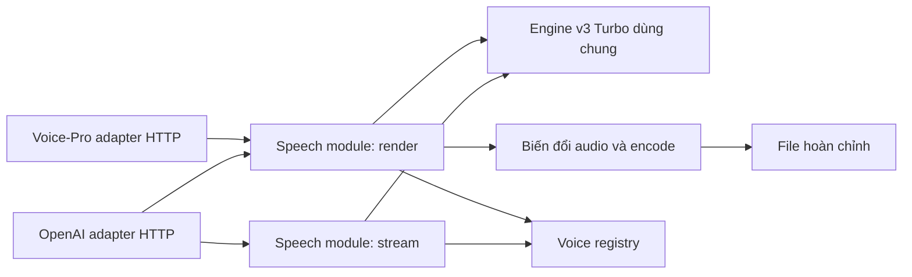

# Thiết kế tích hợp TTS với Voice-Pro

Trạng thái: đã triển khai phía server; xem [hướng dẫn chạy](voice-pro-api.vi.md).
Kiểm tra HTTP dùng model giả và FFmpeg thật; chưa xác nhận tích hợp thực tế với dự án Voice-Pro.
Đầu vào: [yêu cầu Voice-Pro](tts-api-requirements.vi.md) và [ADR 0001](adr/0001-openai-compatible-tts-api.md).
Hợp đồng máy đọc được: [OpenAPI Voice-Pro](openapi.voice-pro.yaml).

## 1. Quyết định thiết kế

Thêm `POST /v1/tts` làm adapter HTTP cho Voice-Pro trong cùng ứng dụng FastAPI. Adapter này dùng chung engine v3 Turbo, danh sách giọng và cơ chế giới hạn tài nguyên với `/v1/audio/speech`. Voice-Pro nhận file hoàn chỉnh trực tiếp; mỗi câu là một request độc lập. Voice-Pro tiếp tục chịu trách nhiệm chia câu, ghép audio và căn thời gian phụ đề.

Giữ hợp đồng streaming mặc định của `/v1/audio/speech`. Chế độ `stream=false` đã thống nhất trước đây dùng chung module tạo file hoàn chỉnh. Voice-Pro dùng `/v1/tts` nên không phụ thuộc vào việc OpenAI client có hỗ trợ trường mở rộng này hay không.

Backbone, Device và batch size tiếp tục thuộc cấu hình server. V1 phục vụ v3 Turbo; không tải lại model theo request. Không cung cấp URL kết quả hoặc giao thức polling trong hợp đồng này.

## 2. Đối chiếu trước khi triển khai

Các nhận định ở cột hiện trạng mô tả baseline `cc58ee7` của `apps/openai_speech.py`, trước phần triển khai Voice-Pro.

| Yêu cầu Voice-Pro | Hiện trạng | Thay đổi thiết kế |
|---|---|---|
| Unicode và giọng cụ thể | Có `input`, `voice`; giọng hiện có thể bỏ qua | `/v1/tts` dùng `text`, bắt buộc `voice` |
| File hoàn chỉnh trước khi thành công | Luôn `StreamingResponse`; WAV dùng kích thước chưa biết | Sinh vào file tạm, encode và kiểm tra xong mới trả `200` |
| MP3, WAV, FLAC | Chỉ PCM/WAV streaming | Thêm pipeline xuất ba container hoàn chỉnh |
| Rate, volume, pitch | Chưa có; `speed` được nhận nhưng bỏ qua | Hậu xử lý với đơn vị và giới hạn tường minh |
| Giọng có locale, ID ổn định | ID đang là tên preset; thiếu locale | Bổ sung metadata; giữ ID cũ và registry bền vững |
| API key | Đã có Bearer, tùy cấu hình | Profile Voice-Pro yêu cầu key khi khởi động |
| Lỗi có mã ổn định | `code` thường là số HTTP | Endpoint mới dùng mã chuỗi và request ID |
| Giới hạn, timeout, retry | Có slot, hàng đợi và timeout chờ | Công bố capability và bổ sung deadline, giới hạn audio |
| Giọng upload sống qua restart | Hiện chỉ lưu trong tiến trình | Ghi registry bền vững trước khi xác nhận đăng ký |

FFmpeg không được cài tường minh trong hai Dockerfile CPU/GPU hiện tại; phải bổ sung và kiểm tra encoder/filter ở profile Voice-Pro.

## 3. Tổng hợp: `POST /v1/tts`

Yêu cầu `Content-Type: application/json`, JSON UTF-8, `Authorization: Bearer <API_KEY>`.

```json
{
  "text": "Xin chào, đây là câu cần đọc.",
  "voice": "Trúc Ly",
  "rate": 0,
  "volume": 0,
  "pitch": 0,
  "format": "mp3"
}
```

| Trường | Bắt buộc | Mặc định | Quy ước |
|---|---|---|---|
| `text` | Có | — | 1–20.000 Unicode code point, phải có ký tự ngoài khoảng trắng |
| `voice` | Có | — | ID từ `GET /v1/voices`; không tự chuyển sang giọng mặc định nếu sai |
| `rate` | Không | `0` | Số hữu hạn, phần trăm, từ `-90` đến `200` |
| `volume` | Không | `0` | Số hữu hạn, phần trăm biên độ, từ `-100` đến `100` |
| `pitch` | Không | `0` | Số hữu hạn, **cent**, từ `-400` đến `400`; 100 cent = 1 semitone |
| `format` | Không | `mp3` | `mp3`, `wav`, `flac`, phân biệt chữ hoa/thường |
| `temperature` | Không | `0.8` | Số hữu hạn, từ `0` đến `2` |
| `max_chars` | Không | `256` | Số nguyên từ `64` đến `512`, giới hạn chia text chunk |

Không ép chuỗi hoặc boolean thành số. Trường không biết, `null` thay giá trị bắt buộc/tùy chọn có mặc định, NaN/Infinity, request JSON không phải object đều trả `400 invalid_request`. JSON body vượt 256 KiB trả `413 request_too_large`. Với `text` đúng kiểu nhưng dài quá giới hạn, ưu tiên `413 text_too_long` thay lỗi validation `400`.

Đếm code point trên chuỗi đầu vào đã giải mã JSON trước chuẩn hóa; không âm thầm cắt văn bản. Model vẫn có thể chuẩn hóa cách đọc. Đầu vào là văn bản thường: không parse SSML, HTML, timestamp hay XML và không hỗ trợ tùy chọn SSML. Ký tự `<`, `>` không được thực thi như markup.

`format` quyết định codec. Bỏ `Accept` hoặc dùng `*/*` được chấp nhận; nếu có `Accept` thì phải cho phép MIME của định dạng đã chọn, nếu không trả `406 not_acceptable`. Không tự đổi codec theo `Accept`.

### Phản hồi thành công

```http
HTTP/1.1 200 OK
Content-Type: audio/mpeg
Content-Disposition: attachment; filename="speech-<request_id>.mp3"
Content-Length: <actual_file_size>
Cache-Control: no-store
X-Request-Id: <request_id>
X-Sample-Rate: 48000
X-Audio-Duration: <decoded_duration_seconds>
```

Body là file hoàn chỉnh, không phải SSE, PCM trần hay JSON chứa URL. Server chỉ bắt đầu trả `200` sau khi synthesis, hậu xử lý, encode và kiểm tra container thành công. Việc truyền file qua HTTP vẫn có thể bị đứt do mạng; client kiểm tra đủ bytes theo `Content-Length` và ghi file đích một cách nguyên tử.

| Format | MIME | Mã hóa |
|---|---|---|
| `mp3` | `audio/mpeg` | MP3 mono, 48 kHz, 192 kbit/s |
| `wav` | `audio/wav` | PCM signed 16-bit little-endian mono, 48 kHz; RIFF/data có kích thước thật |
| `flac` | `audio/flac` | FLAC mono, 48 kHz, mẫu 16-bit |

Mỗi request phải sinh được mẫu audio hữu hạn, không rỗng; im lặng có chủ đích do `volume=-100` vẫn hợp lệ. File phải có stream audio đúng codec/sample rate, số mẫu giải mã dương và kích thước không vượt giới hạn. Không trả `200` với file rỗng hoặc file encode dở.

### Hậu xử lý rate, volume, pitch

Đây là biến đổi audio sau synthesis, không phải điều khiển ngữ điệu nội tại của backbone.

- `tempo_factor = 1 + rate / 100`: `rate=100` là đọc nhanh gấp hai, `rate=-50` là chậm còn một nửa. `rate=-100` làm hệ số bằng 0 nên bị từ chối; Voice-Pro cần giới hạn slider thấp nhất ở `-90`.
- `pitch_factor = 2 ** (pitch / 1200)`: tăng pitch giữ nguyên thời lượng mục tiêu. Không coi giá trị pitch là Hz.
- `amplitude_gain = 1 + volume / 100`: `volume=-100` là tắt tiếng, `volume=100` là nhân đôi biên độ. Sau gain, giới hạn đỉnh ở -1 dBFS bằng limiter có bù latency để tránh tràn mẫu; peak limit có thể làm mức tăng thực tế thấp hơn mức yêu cầu. Không tự chuẩn hóa từng câu.

Chọn FFmpeg có `rubberband` để xử lý tempo/pitch độc lập, bảo toàn formant, sau đó gain/limiter rồi encode. FFmpeg mô tả `tempo` và `pitch` của filter này là hệ số; filter cần build với `--enable-librubberband`. Đây là căn cứ chọn pipeline, không phải bằng chứng chất lượng giọng đã được đo: [tài liệu FFmpeg chính thức](https://raw.githubusercontent.com/FFmpeg/FFmpeg/master/doc/filters.texi).

## 4. Giọng và danh sách capability

### `GET /v1/voices`

Giữ envelope hiện có `{ "object": "list", "data": [...] }`; không đổi thành `{ "voices": [...] }` vì có client cũ. Tài liệu yêu cầu cho phép một lớp chuyển đổi trong Voice-Pro nên adapter đọc trường `data`.

```json
{
  "object": "list",
  "data": [
    {
      "id": "Trúc Ly",
      "name": "Trúc Ly",
      "locale": "vi-VN",
      "gender": "female",
      "formats": ["mp3", "wav", "flac"],
      "description": "Nữ · Bắc · Phong cách tự nhiên",
      "aliases": []
    }
  ]
}
```

Giữ ID preset đang công bố làm ID ổn định; tên hiển thị có thể thay đổi mà ID không đổi. Không sinh lại ID từ tên hiển thị ở mỗi lần chạy. Alias cũ vẫn có thể resolve ở server, nhưng Voice-Pro lưu ID chuẩn từ danh sách. Giọng upload mới được cấp ID `usr_<uuid>` bất biến, tách khỏi `name`; không tái sử dụng ID giọng đã xóa.

Registry lưu ID, tên, locale, gender, alias và dữ liệu giọng đã encode. Với giọng dựng sẵn, quản lý metadata/ID trong manifest có version; với giọng upload, lưu dữ liệu trên volume của server. Ghi nguyên tử và kiểm tra trùng ID/alias trước khi publish; chỉ trả thành công sau commit bền vững. Không cho upload thay thế giọng dựng sẵn. `locale` của giọng dựng sẵn khai báo trong manifest, giọng upload lấy metadata đăng ký và mặc định `vi-VN`; đây không phải kết quả tự nhận diện ngôn ngữ.

`POST /v1/voices` hiện có được giữ để đăng ký giọng riêng. Khi profile Voice-Pro được bật, response bổ sung ID bất biến và metadata, còn tên vẫn được giữ làm alias để client cũ có thể gọi giọng bằng tên. Mỗi người dùng trên cùng server nhìn thấy chung registry theo thiết kế self-host đã chốt.

### `GET /v1/tts/capabilities`

Endpoint có Bearer auth, công bố **cấu hình hiệu lực** của instance, không chỉ các giá trị mặc định trong tài liệu. Adapter đọc khi kết nối và dùng để giới hạn UI, chọn định dạng, đặt timeout. Phản hồi tối thiểu gồm:

| Nhóm | Trường/giá trị mặc định |
|---|---|
| Phiên bản | `api_version: "1.0"`, `model: "vieneu-v3-turbo"` |
| Audio | `formats: ["mp3", "wav", "flac"]`, `sample_rate: 48000`, `channels: 1`, `response_mode: "file"` |
| Text | `max_text_chars: 20000`, `text_length_unit: "unicode_code_points"`, `max_request_bytes: 262144`, `ssml: false` |
| Controls | min/max/default/unit cho `rate`, `volume`, `pitch`, `temperature`, `max_chars` |
| Deadline | `request_timeout_seconds: 300`, `queue_timeout_seconds: 10` |
| Kích thước | `max_audio_seconds: 600` áp dụng cho audio thô và kết quả, `max_output_bytes: 67108864` |
| Tải | `max_streams`, `max_queue`, `max_complete_requests`, `encoding_workers` lấy từ instance |
| Rate limit | `requests_per_minute: null`, `policy: "concurrency_and_bounded_queue"` |
| Kết quả | `result_url_ttl_seconds: null` vì chỉ trả file trực tiếp |

`null` ở requests/minute nghĩa là không áp hạn mức request/phút; vẫn có backpressure theo tải. Không gọi giới hạn concurrency là rate limit theo thời gian.

## 5. Lỗi, deadline và retry

```json
{
  "error": {
    "code": "voice_not_found",
    "type": "invalid_request_error",
    "message": "Giọng yêu cầu không tồn tại.",
    "param": "voice",
    "request_id": "tts_..."
  }
}
```

Mọi response thuộc hợp đồng Voice-Pro, kể cả lỗi, có `X-Request-Id`. `param` là tên trường liên quan hoặc `null`. Các route trong OpenAPI Voice-Pro dùng mã chuỗi ổn định khi profile này được bật, bao gồm lỗi của `GET /v1/voices`; route `/v1/audio/speech` giữ hợp đồng lỗi hiện có. Đây là nâng cấp có chủ đích cho lỗi của route liệt kê giọng, còn envelope dữ liệu và ID giọng cũ được giữ nguyên.

| HTTP | `error.code` | Trường hợp / retry |
|---|---|---|
| 400 | `invalid_request`, `unsupported_format`, `unsupported_parameter` | Sai kiểu, trường lạ, vượt phạm vi control; sửa request |
| 401 | `invalid_api_key` | Thiếu/sai Bearer key; không retry tự động |
| 404 | `voice_not_found` | ID không tồn tại; làm mới danh sách giọng |
| 406 | `not_acceptable` | MIME không đáp ứng `Accept` |
| 413 | `request_too_large`, `text_too_long`, `audio_too_large` | Body/text/audio vượt giới hạn; chia nhỏ đầu vào |
| 415 | `unsupported_media_type` | Không gửi JSON |
| 429 | `server_busy` | Hết capacity hoặc chờ queue quá hạn; `Retry-After: 2` |
| 500 | `synthesis_failed`, `encoding_failed`, `invalid_audio` | Sinh/encode thất bại, kết quả không hợp lệ; có thể retry giới hạn |
| 503 | `engine_unavailable` | Engine lỗi hoặc storage tạm không dùng được; `Retry-After: 5` |
| 504 | `synthesis_timeout` | Hết deadline trước khi file sẵn sàng |

Các lỗi route không tồn tại dùng `404 not_found`; lỗi server chưa phân loại dùng `500 internal_error`. Không đưa exception, đường dẫn nội bộ, text đầu vào hoặc API key vào response lỗi. Lỗi từ reverse proxy cần được cấu hình đồng nhất; không hứa mọi proxy bên ngoài đều trả envelope của ứng dụng.

Deadline mặc định 300 giây tính từ lúc nhận đủ body, bao gồm validation, chờ, synthesis, hậu xử lý và kiểm tra file; không bao gồm thời gian truyền file đã hoàn tất. Giới hạn queue 10 giây nằm trong deadline này. Không hứa văn bản 20.000 ký tự luôn hoàn thành trong 300 giây; Voice-Pro nên tiếp tục gửi theo câu.

Client đặt connect timeout 5 giây, read timeout 330 giây và tối đa 60 giây cho giai đoạn tải file sau khi nhận header. Proxy upstream read timeout ít nhất 330 giây. Timeout ở server phải hủy đăng ký stream và dọn FFmpeg/file tạm; không chỉ dừng chờ coroutine rồi bỏ engine chạy vô hạn. Nếu một bước native chưa thể ngắt ngay, tác vụ vẫn giữ permit tài nguyên cho đến khi dừng thực sự; phản hồi `504` không cho phép tái sử dụng slot đang chạy.

Voice-Pro retry tối đa hai lần sau lần đầu khi lỗi kết nối, `429`, `500`, `503`, `504`, có backoff và jitter; ưu tiên `Retry-After`, giới hạn trong ngân sách retry của ứng dụng. Không retry lỗi `4xx` khác. Mỗi lần gọi độc lập, không ghi đè kết quả request khác, nhưng retry có thể sinh lại audio khác do sampling. V1 không bảo đảm exactly-once, cache hay dedup theo `Idempotency-Key`.

## 6. Module và vòng đời tài nguyên

Hai adapter HTTP đi qua một seam nội bộ cho module speech. Interface dự kiến là `stream(request) -> iterator[AudioChunk]` và `render(request) -> RenderedAudio`; dependency engine, registry và encoder được truyền vào khi khởi tạo. `RenderedAudio` sở hữu file tạm, metadata và hành vi cleanup; caller không cần biết cách ghép chunk, chọn filter, encode hay kiểm tra container.



Các vị trí dự kiến: `apps/openai_speech.py` giữ app/auth và wiring; `apps/tts_api.py` chứa schema/route Voice-Pro; `apps/speech_service.py` quản lý synthesis và render; `apps/audio_encoding.py` sở hữu FFmpeg, container và cleanup. Đây là tổ chức dự kiến, không thêm interface trừu tượng chỉ để chuyển tiếp mỗi lời gọi.

Luồng render:

1. Xác thực, giới hạn body, validation và resolve voice; chụp snapshot dữ liệu giọng cho request.
2. Lấy permit request hoàn chỉnh, sau đó slot synthesis dùng chung với streaming. Tất cả hàng đợi hữu hạn và bị ràng buộc bởi deadline.
3. Thu audio vào spool/file tạm riêng từng request, giữ float cho đến bước xuất; kiểm tra hữu hạn, số mẫu và thời lượng trong lúc sinh.
4. Hoàn thành hoặc hủy synthesis thì trả slot engine đúng một lần. Tiếp tục giữ permit request hoàn chỉnh trong giai đoạn encode và tải file.
5. Lấy slot encoder trong deadline còn lại; hậu xử lý và encode vào file riêng, giới hạn thời lượng và số byte đầu ra.
6. Kiểm tra file bằng metadata và giải mã audio; file lỗi hoặc không có mẫu trả lỗi JSON trước `200`. WAV phải được finalise trên file seekable để có kích thước RIFF/data đúng.
7. Trả file với kích thước thật. Khi gửi xong, client ngắt kết nối hoặc có lỗi, dọn tất cả file và trả permit request hoàn chỉnh đúng một lần.

Giới hạn số render đang hoạt động gồm cả chờ encode và truyền file: mặc định `VIENEU_MAX_COMPLETE_REQUESTS = max_streams`. Encoder có pool riêng mặc định hai tiến trình đồng thời. Không tạo model thứ hai cho `/v1/tts`, không thêm worker Uvicorn để nhân bản engine ngoài kiểm soát. Hàng đợi cho các permit có tổng số người chờ bị giới hạn bởi `VIENEU_QUEUE`; không nhân thành các queue vô hạn ở mỗi bước.

FFmpeg chạy bằng argv với `shell=False`, filter chỉ được xây từ giá trị đã validation. Bật chế độ không đọc stdin tương tác, đặt số thread, giới hạn subprocess và deadline còn lại; hủy thì terminate/kill rồi wait. Thư mục tạm có giới hạn dung lượng, quyền riêng và cleanup cả khi lỗi trước lần đọc response đầu tiên. Sau crash, lần khởi động sau thu dọn thư mục job cũ của chính instance trước khi nhận tải.

## 7. Cấu hình triển khai

Các biến dưới đây được đọc khi bật profile Voice-Pro:

```dotenv
# Server: các biến hiện có
HOST=0.0.0.0
PORT=8000
VIENEU_API_KEY=replace_with_your_key
VIENEU_BACKEND=auto
VIENEU_DEVICE=auto
VIENEU_QUEUE_TIMEOUT=10

# Server: bổ sung cho hợp đồng Voice-Pro
VIENEU_VOICE_PRO_ENABLED=1
VIENEU_HOME=/data/vieneu
VIENEU_FFMPEG_PATH=ffmpeg
VIENEU_TTS_TIMEOUT=300
VIENEU_MAX_TEXT_CHARS=20000
VIENEU_MAX_REQUEST_BYTES=262144
VIENEU_MAX_AUDIO_SECONDS=600
VIENEU_MAX_OUTPUT_BYTES=67108864
VIENEU_ENCODING_WORKERS=2
# VIENEU_MAX_COMPLETE_REQUESTS: mặc định bằng max_streams hiệu lực
```

Khi `VIENEU_VOICE_PRO_ENABLED=1`, thiếu key, encoder `libmp3lame`/`pcm_s16le`/`flac`, filter `rubberband` hoặc thư mục dữ liệu/tạm không ghi được sẽ làm startup thất bại rõ ràng. Profile Voice-Pro phải cung cấp đủ cả ba định dạng và controls đã công bố. Khi không bật profile này, server vẫn có thể chạy local theo cấu hình API key tùy chọn đã chốt. Kiểm tra khả năng decode và encoder/filter khi startup, không phát hiện thiếu thư viện sau khi khách hàng đã đợi synthesis.

Mount `VIENEU_HOME` vào volume bền vững và truyền biến mới vào hai profile Docker API CPU/GPU; giữ một worker Uvicorn. `/health` thể hiện readiness của engine/encoder/storage, không trả secret. Capability trả giới hạn cấu hình thực tế, không để giới hạn reverse proxy nhỏ hơn giới hạn đã công bố.

## 8. Adapter cần làm trong Voice-Pro

```dotenv
CUSTOM_TTS_BASE_URL=http://vieneu-host:8000
CUSTOM_TTS_API_KEY=replace_with_your_key
```

Base URL không bao gồm `/v1`. Adapter gọi `GET /v1/tts/capabilities` và `GET /v1/voices`, sau đó `POST /v1/tts`, dùng cùng Bearer key.

| Dữ liệu Voice-Pro | Request / cách xử lý |
|---|---|
| Câu text hiện tại | `text`, gửi nguyên Unicode |
| Lựa chọn giọng UI | ID từ API, không lấy Azure ID rồi giả định trùng |
| Slider tốc độ | `rate`, giới hạn `-90..200` theo capability |
| Slider âm lượng | `volume`, `-100..100`, 0 là biên độ nguyên bản |
| Slider pitch đang ghi Hz | Đổi nhãn sang **cent** cho provider VieNeu, reset 0 khi đổi provider; gửi `pitch` |
| Format UI | `mp3`/`wav`/`flac`; MIME và phần mở rộng file theo format |
| Rate/pitch đã dùng khi ghép phụ đề | Không áp lại effects ở client; căn thời gian dựa trên duration audio kết quả |

Không tồn tại phép đổi Hz sang cent cố định khi không có tần số tham chiếu. Vì vậy không chuyển nguyên cấu hình pitch Hz của provider cũ sang provider VieNeu. Nếu chưa thể sửa UI/config pitch trong Voice-Pro, giai đoạn tích hợp đầu khóa pitch ở 0 và chỉ gửi 0, thay vì gửi một giá trị sai đơn vị.

Voice-Pro đọc `voices.data`, hiển thị `name`/`locale`, lưu `id`; không cần dùng `vi-VN-HoaiMyNeural` của Microsoft. Metadata `gender` dùng `male`, `female`, hoặc `unknown`; adapter ánh xạ sang cách hiển thị sẵn có nếu cần. Việc tương thích này cần sửa adapter ở dự án Voice-Pro, không phải server trả giọng VieNeu dưới ID giả của Microsoft.

Khi nhận audio: kiểm tra status, Content-Type và đủ Content-Length; ghi file `.part`, kiểm tra giải mã được rồi rename sang đường dẫn đích. Khi lỗi: đọc JSON nếu có, ghi code/request ID và xóa file dở. Audio im lặng do volume=-100 vẫn là file hợp lệ. Không trộn JSON lỗi vào file đích. Request không có trạng thái hội thoại, nên nhiều câu liên tiếp không phụ thuộc thứ tự gọi; không bảo đảm continuity ngữ điệu giữa các request.

## 9. Trình tự triển khai và tiêu chí nghiệm thu

1. Tách speech module từ route hiện có, giữ hành vi streaming và kiểm tra hồi quy.
2. Thêm registry bền vững và metadata locale/ID.
3. Thêm renderer, FFmpeg, giới hạn và cleanup, rồi routes `/v1/tts` và capability theo OpenAPI.
4. Nối `stream=false` của endpoint OpenAI vào renderer; chế độ complete ban đầu giữ format PCM/WAV hiện có, SSE chỉ hợp lệ khi stream=true.
5. Cập nhật Docker/config và adapter Voice-Pro theo hướng dẫn trên.

Trước khi tuyên bố sẵn sàng, cần kiểm tra qua interface HTTP: tiếng Việt và ID giọng; giải mã MP3/WAV/FLAC; WAV có kích thước thật; lỗi giữa synthesis/encode vẫn là JSON non-200; duration thay đổi đúng hướng khi đổi rate; pitch không làm thay đổi thời lượng ngoài sai số xử lý; volume=-100 giữ duration và cho mẫu im lặng. Đồng thời kiểm tra giới hạn Unicode, request độc lập/đồng thời, 429/Retry-After, deadline, client disconnect, không rò permit/file/process, voice giữ ID sau restart, và client OpenAI streaming cũ vẫn hoạt động.

Tài liệu này chưa tuyên bố checklist sẵn sàng trong tài liệu yêu cầu đã đạt. Chưa có source Voice-Pro trong workspace để xác minh adapter thực tế; các file tham chiếu của Voice-Pro được lấy từ tài liệu yêu cầu, không coi là đã kiểm tra mã của dự án đó.
